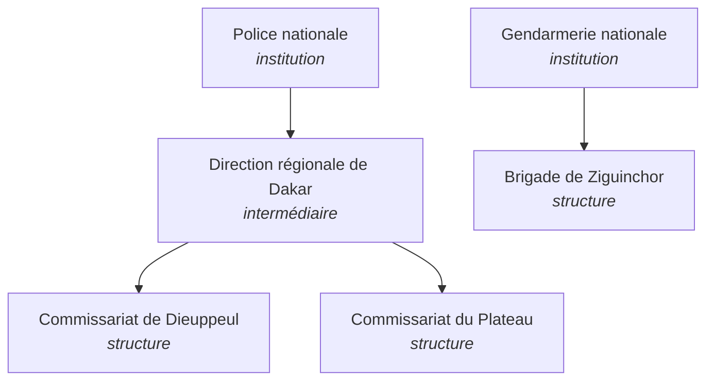
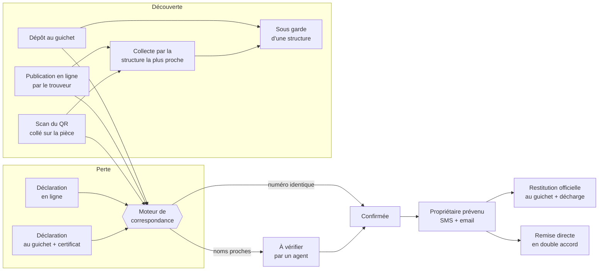
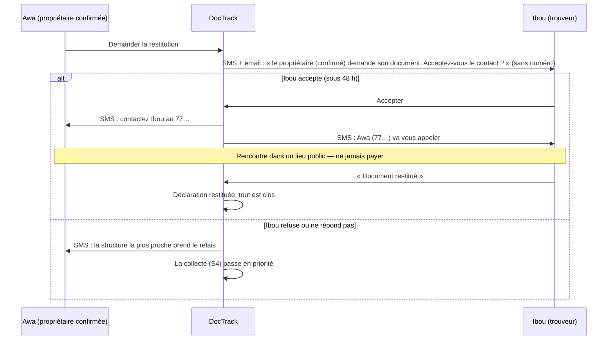
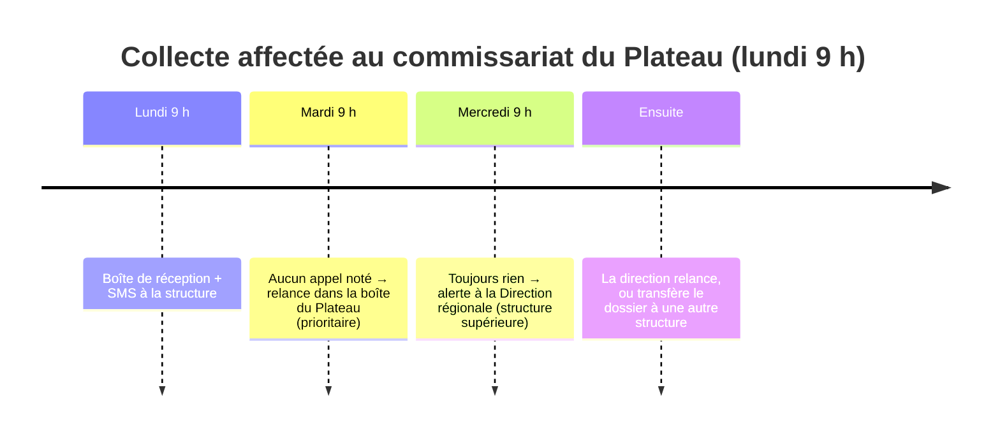
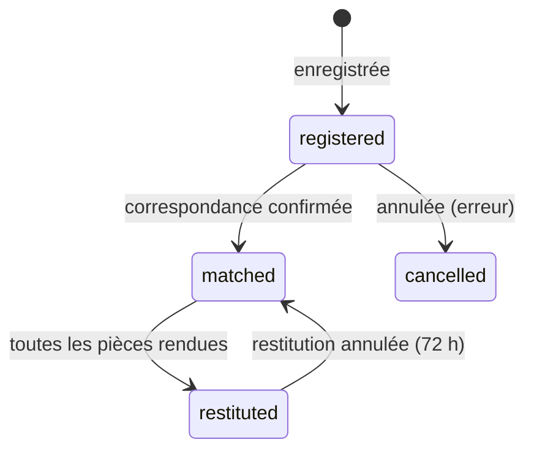
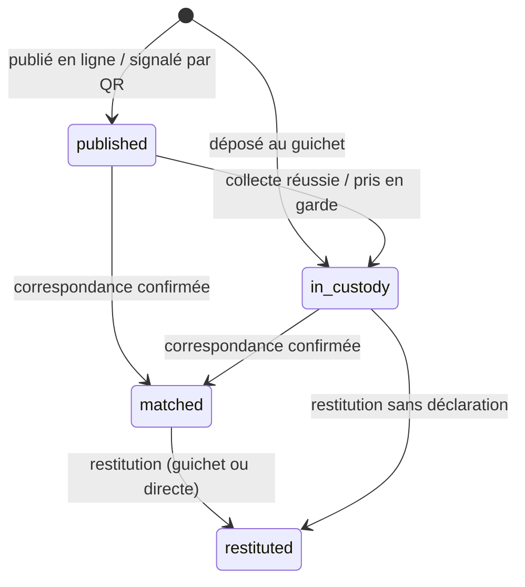

# DocTrack — comprendre la plateforme par des scénarios

> Ce document explique **comment fonctionne DocTrack**, pour le citoyen, les agents, les responsables et les partenaires.
> Chaque processus est raconté par une histoire concrète, puis résumé : qui fait quoi, ce que le système fait tout seul,
> qui est prévenu, et quelles routes d'API sont utilisées.
>
> - Documentation technique de l'API : `/api/documentation/v2` (Swagger), fichier `docs/api/doctrack-v2.openapi.yaml` (importable dans Postman).
> - Les schémas ci-dessous sont en Mermaid : ils s'affichent directement sur GitHub/GitLab et dans la plupart des éditeurs Markdown.

---

## Sommaire

1. [Les acteurs](#1-les-acteurs)
2. [Vocabulaire et références](#2-vocabulaire-et-références)
3. [Vue d'ensemble : le parcours d'un document](#3-vue-densemble--le-parcours-dun-document)
4. Scénarios
   - [S1 — Awa déclare la perte de sa CNI au commissariat](#s1--awa-déclare-la-perte-de-sa-cni-au-commissariat)
   - [S2 — Moussa dépose la CNI trouvée à la brigade](#s2--moussa-dépose-la-cni-trouvée-à-la-brigade)
   - [S3 — Awa récupère sa CNI au guichet (ou son frère pour elle)](#s3--awa-récupère-sa-cni-au-guichet-ou-son-frère-pour-elle)
   - [S4 — Fatou trouve un passeport mais ne veut pas se déplacer](#s4--fatou-trouve-un-passeport-mais-ne-veut-pas-se-déplacer)
   - [S5 — Une correspondance à vérifier par un agent](#s5--une-correspondance-à-vérifier-par-un-agent)
   - [S6 — Remise directe entre citoyens, en double accord](#s6--remise-directe-entre-citoyens-en-double-accord)
   - [S7 — Le QR code collé sur la carte d'Ibrahima](#s7--le-qr-code-collé-sur-la-carte-dibrahima)
   - [S8 — Une structure tarde à rappeler un trouveur](#s8--une-structure-tarde-à-rappeler-un-trouveur)
   - [S9 — Payer une démarche (après la phase pilote)](#s9--payer-une-démarche-après-la-phase-pilote)
   - [S10 — Le rapport du mois arrive chez le Directeur](#s10--le-rapport-du-mois-arrive-chez-le-directeur)
   - [S11 — Corriger une erreur](#s11--corriger-une-erreur)
   - [S12 — Une banque vérifie un certificat](#s12--une-banque-vérifie-un-certificat)
   - [S13 — Awa parle à l'assistant, en wolof](#s13--awa-parle-à-lassistant-en-wolof)
   - [S14 — Moussa scanne la carte qu'il a trouvée](#s14--moussa-scanne-la-carte-quil-a-trouvée)
   - [S15 — Une même photo pour deux noms : la vigilance s'en mêle](#s15--une-même-photo-pour-deux-noms--la-vigilance-sen-mêle)
5. [Cycles de vie (statuts)](#5-cycles-de-vie-statuts)
6. [Règles clés en un tableau](#6-règles-clés-en-un-tableau)
7. [Confidentialité : qui voit quoi](#7-confidentialité--qui-voit-quoi)
8. [Tâches automatiques](#8-tâches-automatiques)
9. [Réglages (fichier .env)](#9-réglages-fichier-env)

---

## 1. Les acteurs

| Acteur | Qui est-ce ? | Ce qu'il fait dans DocTrack |
|---|---|---|
| **Citoyen propriétaire** | La personne qui a perdu un document | Déclare en ligne ou au guichet, reçoit les alertes, demande la restitution, crée des QR pour ses pièces |
| **Trouveur** | Toute personne qui trouve un document | Le dépose au guichet, le publie en ligne ou scanne son QR — sans compte obligatoire dans ce dernier cas |
| **Agent** (`agent`) | Policier / gendarme d'une structure | Enregistre déclarations et dépôts, vérifie les correspondances, appelle les trouveurs, restitue, encaisse |
| **Chef de structure** (`structure_manager`) | Commissaire, commandant de brigade | Comme l'agent + gère ses agents, accorde exonérations et dérogations, annule une remise erronée, voit les statistiques |
| **Responsable d'institution** (`institution_admin`) | Direction de la Police, de la Gendarmerie, direction régionale | Supervise toutes les structures de son périmètre, statistiques et rapports, reçoit les alertes de retard |
| **Super admin** (`super_admin`) | Équipe DocTrack | Crée les institutions, fixe les tarifs, voit le national, traite les dossiers sans structure |

Les organisations sont rangées en arbre :

Un **responsable d'institution** voit toute sa branche ; un **agent** ne voit que sa structure. Un agent affecté à deux
structures choisit celle au nom de laquelle il agit (en-tête `X-Organization`).

---

## 2. Vocabulaire et références

| Référence | Objet | Exemple |
|---|---|---|
| `DT-` | Déclaration de perte | DT-2026-000123 |
| `CP-` | Certificat officiel de perte (émis au guichet) | CP-2026-000045 |
| `TR-` | Document trouvé | TR-2026-000031 |
| `RS-` | Décharge de restitution officielle | RS-2026-000001 |
| `FA-` | Reçu de frais / paiement | FA-2026-000210 |
| `RP-` | Rapport d'activité | RP-2026-000007 |

- **Correspondance** : rapprochement proposé par le moteur entre une pièce déclarée perdue et un document trouvé, avec un **score sur 100** expliqué critère par critère.
- **Collecte** : la structure la plus proche va chercher un document chez le trouveur (ou le fait venir).
- **Garde** : le document est physiquement conservé par une structure.
- **Code de vérification** : 12 caractères imprimés sous le QR d'un certificat ou d'une décharge ; permet à n'importe qui d'en vérifier l'authenticité.

---

## 3. Vue d'ensemble : le parcours d'un document

---

## 4. Scénarios

### S1 — Awa déclare la perte de sa CNI au commissariat

**Histoire.** Awa Ndiaye a perdu son sac au marché HLM : carte d'identité et permis. Elle se présente au commissariat de
Dieuppeul. Elle n'a pas de compte DocTrack.

**Étapes**

1. L'agent cherche si Awa est déjà connue (par téléphone ou nom) — `GET /api/v2/citizens?phone=…`.
   Inconnue : il l'enregistre (nom, date de naissance, téléphone).
2. Il saisit **une seule déclaration pour les deux pièces** (CNI + permis), avec les numéros s'ils sont connus —
   `POST /api/v2/declarations`.
3. DocTrack crée la déclaration **DT-2026-000123**, chiffre les numéros (jamais stockés en clair) et crée le frais
   de déclaration (voir S9).
4. Le frais étant réglé (gratuit pendant la phase pilote), DocTrack délivre **le certificat officiel CP-…** en PDF,
   avec le nom de l'agent, son matricule et un QR de vérification — `GET /api/v2/declarations/{uuid}/certificate`.
5. Awa reçoit un **SMS de reçu** : référence + lien de vérification du certificat.
6. En arrière-plan, le **moteur de correspondance** compare les deux pièces avec tous les documents trouvés.

**Ce que le système fait tout seul** : référence, chiffrement, certificat, SMS, recherche de correspondances.

**Variantes**
- *Awa déclare en ligne depuis chez elle* : elle obtient un **récépissé** (pas un certificat officiel) ; la recherche de correspondances est la même.
- *Erreur de saisie* : voir S11.

---

### S2 — Moussa dépose la CNI trouvée à la brigade

**Histoire.** Moussa trouve la CNI d'Awa à l'arrêt de bus et la dépose à la brigade la plus proche.

1. L'agent **scanne** la carte (S14 : champs pré-remplis, NIN lu au dos, numéros masqués sur la photo publique) — `POST /api/v2/ocr/scan` —,
   vérifie, ajoute le lieu et, si Moussa le souhaite, ses coordonnées — `POST /api/v2/found-documents` (+ `ocr_scan_id`).
   Sans scan, il saisit tout à la main comme avant. Le document devient **TR-2026-000031**, **sous la garde** de la brigade.
2. Moussa reçoit un **SMS de remerciement**.
3. Le moteur trouve la déclaration d'Awa : **même numéro** → la correspondance est **confirmée automatiquement**.
4. Awa reçoit un **SMS** (et un email si elle a un compte) : « votre CNI a été retrouvée, elle est conservée par la brigade X (tél.), réf. TR-… ».
5. La déclaration d'Awa passe à « correspondance trouvée » ; la pièce CNI à « trouvée ».

> **Comment le moteur compare-t-il ?** Noms (70 pts) — tolère les fautes, les prénoms/noms inversés et les graphies
> sénégalaises (Ndiaye / Njaay / N'Diaye, Mouhamadou / Mohamed / Modou, Diop / Joop…) ; date de naissance (15 pts) ;
> cohérence des dates (10 pts) ; même région (5 pts). Un **numéro identique** est décisif ; un numéro **différent**
> plafonne le score à 30 ; une date de naissance différente le plafonne à 45 (homonymes).
> - score ≥ 75 → **à vérifier** par un agent (S5) ; 55 à 74 → **proposée** ; numéro identique → **confirmée**.
> - Une paire rejetée par un agent n'est **jamais reproposée**.
> - Noms mal orthographiés : orthographe wolof (Caw = Thiaw, Xadi = Khady, Jeju = Diédhiou…), mots collés par l'OCR
>   (« MOUSSAIBRAHIMA »), chiffres lus à la place de lettres (« NDIAY3 »), prénom composé incomplet (« Mame Diarra » / « Diarra »).
>   Les équivalences se complètent dans `config/matching.php`.

---

### S3 — Awa récupère sa CNI au guichet (ou son frère pour elle)

**Histoire.** Awa se présente à la brigade avec son passeport comme pièce d'identité.

1. L'agent ouvre le document et prépare la remise — `GET /api/v2/found-documents/{uuid}/restitution` :
   il voit la déclaration liée et la liste des contrôles à faire.
2. Il vérifie l'identité et coche **« la photo de la pièce correspond à la personne »**.
3. Il **scanne la pièce présentée** (`POST /api/v2/ocr/scan`, `purpose=identity_check` : **aucune photo conservée**) : type, numéro,
   nom et date de naissance sont lus. Ou il les saisit à la main. Puis il valide — `POST /api/v2/found-documents/{uuid}/restitution`
   (+ `owner.ocr_scan_id`). DocTrack vérifie :
   - la pièce scannée est bien **au nom de la personne** (sinon : refus, « la pièce est au nom de … ») ;
   - la pièce présentée **n'est pas le document à restituer** (même numéro) : sinon refus et **alerte de vigilance haute** (S15) ;
   - le **nom** présenté correspond au document (variantes acceptées) ; sinon, seul un **chef** peut déroger en écrivant le motif (ex. nom d'épouse) ;
   - une **date de naissance différente est toujours refusée** ;
   - on ne garde **aucune copie** de la pièce : seulement son type et ses 4 derniers chiffres.
4. DocTrack génère la **décharge RS-2026-000001** (PDF) : l'agent l'imprime, Awa signe « lu et approuvé », l'agent contresigne.
   Le scan signé peut être joint — `POST /api/v2/restitutions/{uuid}/signed-scan`.
5. Tout se clôt : document « restitué », déclaration « restituée », autres propositions sans objet.
6. Awa reçoit un **SMS de reçu** (référence + lien de vérification) ; Moussa reçoit « le document a été rendu, merci ».

**Variante : procuration.** Awa est à Thiès ; son frère Mamadou vient avec **sa propre pièce** et une **procuration**.
L'agent choisit « mandataire », saisit les deux identités et coche « procuration vérifiée ». La décharge porte
« Mamadou Ndiaye, agissant pour le compte d'Awa Ndiaye ». La procuration peut être interdite pour certains types
(ex. passeport) par le super admin.

**Variante : pas de déclaration.** Une personne vient chercher un document sans l'avoir déclaré : c'est possible après
les mêmes contrôles ; la remise est marquée « sans déclaration préalable » (visible dans les statistiques).

---

### S4 — Fatou trouve un passeport mais ne veut pas se déplacer

**Histoire.** Fatou trouve un passeport au marché Sandaga. Elle n'a pas le temps d'aller au commissariat.

1. Depuis l'application, elle **scanne** le passeport : le type, le nom, les prénoms et le numéro se remplissent seuls
   (voir S14) — `POST /api/v2/ocr/scan`. Elle vérifie, partage sa **position GPS**, choisit son département et coche
   **« j'accepte d'être contacté par la structure la plus proche »**, puis publie — `POST /api/documents` (+ `ocr_scan_id`).
   Sur la photo publique, les numéros sont **masqués** puis l'image est floutée.
2. DocTrack choisit la structure : **la plus proche en GPS (≤ 25 km)**, sinon une structure du **même département**,
   puis de la **même région**. Ici : le commissariat du Plateau.
3. Le Plateau reçoit : un message dans sa **boîte de réception**, un **SMS** au numéro de la structure (et un email si elle en a un).
   Fatou reçoit : « le commissariat du Plateau (tél.) va vous appeler ».
4. Un agent ouvre la fiche (le numéro de Fatou n'apparaît qu'ici, et chaque consultation est enregistrée),
   l'appelle et note le résultat — `POST /api/v2/collections/{uuid}/contact` (joint / pas de réponse / numéro erroné).
5. Il organise la récupération — `POST /api/v2/collections/{uuid}/plan` :
   **Fatou passe déposer** le document, ou **un agent vient le chercher** (date, lieu). Fatou reçoit le rendez-vous par SMS.
6. À réception — `POST /api/v2/collections/{uuid}/collected` : le document passe sous la garde du Plateau ;
   Fatou reçoit un SMS de remerciement ; si le propriétaire était déjà prévenu, il reçoit « votre document est maintenant au Plateau ».

**Si la structure ne peut pas** : elle **refuse** (le dossier part automatiquement à la suivante la plus proche) ou le
**transfère** à une structure précise avec un motif. Si plus aucune structure n'est disponible, le super admin est alerté.

---

### S5 — Une correspondance à vérifier par un agent

**Histoire.** Un document trouvé porte « Awa **Njaay** », sans numéro. La déclaration dit « Awa **Ndiaye** ».

1. Le moteur calcule un score de 91 → **à vérifier**. La structure qui garde le document reçoit un message dans sa boîte.
2. L'agent ouvre la file — `GET /api/v2/matches` — et compare les deux fiches côte à côte, avec l'explication du score
   (noms 0,97 ; date de naissance ; lieu…). Le téléphone du déclarant n'est jamais affiché.
3. Il **confirme** (le propriétaire est prévenu par SMS + email) ou **rejette** avec un motif (la paire ne reviendra plus).
4. Sans action sous 48 h, la structure reçoit une relance (voir S8).

---

### S6 — Remise directe entre citoyens, en double accord

**Histoire.** Awa a déclaré sa perte en ligne. Ibou a trouvé la carte et l'a publiée en ligne. Le moteur confirme la
correspondance (même numéro). Awa est prévenue et clique « Demander la restitution ».

**Règles importantes**
- Seul le **propriétaire confirmé** par DocTrack (correspondance confirmée liée à sa déclaration) peut demander.
  Quelqu'un d'autre reçoit : « faites d'abord une déclaration de perte ».
- **Aucun numéro n'est échangé avant l'accord du trouveur.**
- Si le document est déjà sous la garde d'une structure, la demande en ligne renvoie vers le guichet (S3).
- La remise directe et la collecte peuvent coexister ; la structure voit dans l'historique qu'une remise directe se prépare.

Routes : `POST /api/documents/{uuid}/restitution`, `GET /api/restitution-requests`, `POST …/accept`, `…/decline`, `…/cancel`.

---

### S7 — Le QR code collé sur la carte d'Ibrahima

**Histoire.** Ibrahima crée dans son espace un **QR pour sa CNI** (le premier est gratuit), l'imprime et le colle au dos
de la pochette — `POST /api/document-tags`. Des mois plus tard, Khady trouve la pochette et scanne le QR.

1. Khady voit une page DocTrack **sans aucune donnée personnelle** : « ce document appartient à un utilisateur DocTrack »
   — `GET /api/v2/tags/{token}`.
2. Elle indique son numéro, le lieu (ou son GPS) et si elle accepte d'être appelée par la structure la plus proche
   — `POST /api/v2/tags/{token}/found`.
3. Ibrahima reçoit **immédiatement** SMS + email (lieu, structure qui va récupérer, et le numéro de Khady si elle l'a autorisé).
4. Si Khady a accepté : une **collecte** s'ouvre (S4) ; quand la structure a le document, Ibrahima reçoit « conservé par X ».
5. Un même trouveur ne peut pas déclencher plusieurs alertes en 24 h ; le QR peut être **désactivé** à tout moment.

**Renouvellement** (QR abîmé) : `POST /api/document-tags/{uuid}/renew` — frais `qr_renewal` (gratuit en pilote,
payable par Wave ensuite). L'ancien QR est désactivé au règlement.

---

### S8 — Une structure tarde à rappeler un trouveur

- Les délais se règlent dans `config/doctrack.php` (`sla`) : 1er appel 24 h, alerte 48 h, récupération 72 h, vérification de correspondance 48 h.
- Chaque relance n'est envoyée qu'**une fois** ; un transfert remet les compteurs à zéro pour la nouvelle structure.
- Les retards apparaissent dans les statistiques (`GET /api/v2/stats/structures`, `GET /api/v2/stats/overdue-collections`) et dans les rapports (S10).

---

### S9 — Payer une démarche (après la phase pilote)

| Mode | Réglage | Effet |
|---|---|---|
| **Pilote** (actuel) | `BILLING_MODE=pilot` | Tout est **gratuit**, mais chaque démarche est enregistrée avec sa **valeur théorique** (ce qui aurait été perçu). |
| **Live** | `BILLING_MODE=live` | Le **certificat n'est délivré qu'après paiement** (ou exonération). |

Tarifs par défaut (modifiables par le super admin, éventuellement par institution) : déclaration **3 000 FCFA**,
renouvellement de QR **1 000 FCFA**, restitution **gratuite**. Chaque paiement est partagé **50 / 50** entre les autorités et DocTrack.

**Au guichet, en mode live**
1. La déclaration est enregistrée ; le frais **FA-…** est « en attente » ; pas encore de certificat.
2. Trois possibilités :
   - **Espèces** : l'agent encaisse et saisit le montant reçu ; DocTrack calcule la monnaie — `POST /api/v2/charges/{uuid}/cash` ;
   - **Wave** : l'agent génère un lien, le citoyen paie avec son téléphone — `POST /api/v2/charges/{uuid}/checkout` ;
     Wave confirme à DocTrack (notification signée, vérifiée) ;
   - **Exonération** : un chef l'accorde avec un motif (indigence, victime d'agression…) — `POST /api/v2/charges/{uuid}/exempt`.
3. Dès que le frais est réglé : certificat + SMS de reçu.

**Chaque mois** : `GET /api/v2/billing/report?month=2026-10` donne ce qui a été perçu, la part des autorités, la part DocTrack,
les exonérations, la valeur théorique du pilote — en JSON ou CSV.

---

### S10 — Le rapport du mois arrive chez le Directeur

**Histoire.** Le 1er novembre à 6 h 15, DocTrack produit le rapport d'octobre pour le **national** et pour **chaque institution**.

0. **Synthèse rédigée avec l'aide de l'IA** (si `AI_REPORTS_ENABLED=true`) : un modèle de langage (Qwen, puis GLM en secours) reçoit
   **uniquement les chiffres agrégés** du rapport (aucun nom, numéro ni téléphone ; effectifs < 3 masqués) et rédige : synthèse,
   constats clés, commentaire par structure, recommandations priorisées et **résumé en anglais**.
   **Chaque nombre du texte est vérifié** : s'il n'existe pas dans les données, le texte est rejeté (nouvelle tentative, fournisseur suivant,
   sinon analyse par règles seule). Le super admin reçoit « Rapport à valider » : il relit, **corrige si besoin**, puis valide
   (`POST /api/v2/reports/{uuid}/narrative/approve`) ou refuse (`…/reject`). **Rien n'est envoyé aux directeurs avant sa décision.**
   Le rapport indique que la synthèse a été rédigée avec l'aide de l'IA, vérifiée et validée.
1. Le Directeur de la Police trouve dans sa boîte de réception « Rapport d'activité — Octobre 2026 (Police nationale) » et reçoit un email.
2. Il télécharge le **PDF** (synthèse, niveau global sur 100, alertes, recommandations, évolution, délais de chaque structure,
   types de documents, régions, finances) et le **classeur Excel** (mêmes données, une feuille par thème)
   — `GET /api/v2/reports/{uuid}/pdf`, `…/xlsx`.
3. Un chef de commissariat peut générer le rapport de **sa** structure pour n'importe quelle période — `POST /api/v2/reports`.

L'analyse applique des **règles publiées** (ex. « moins de 70 % des trouveurs appelés sous 24 h » → alerte critique) :
chaque alerte cite le chiffre qui la déclenche. Aucune donnée personnelle n'apparaît dans un rapport.

Statistiques en direct : `GET /api/v2/stats/overview`, `/structures` (+ CSV), `/timeseries`.

---

### S11 — Corriger une erreur

| Erreur | Qui peut corriger | Délai | Effet |
|---|---|---|---|
| Déclaration mal saisie | L'agent auteur, ou un chef | 24 h pour l'agent | Déclaration annulée, certificat **révoqué** (la vérification publique l'indique), SMS à la victime, propositions sans objet |
| Correspondance erronée (pas encore confirmée) | Tout agent habilité | — | Rejet motivé ; la paire n'est plus jamais proposée |
| Document remis à la mauvaise personne | Un chef ou le responsable d'institution | 72 h | Restitution **annulée**, le document revient sous garde, la décharge devient « annulée » à la vérification |
| Mauvaise structure pour une collecte | La structure | — | Transfert motivé ou refus (réaffectation automatique) |
| Frais saisi par erreur | Un chef | Tant qu'il est en attente | Frais annulé |

---

### S12 — Une banque vérifie un certificat

Awa présente son certificat de perte à sa banque. L'employé scanne le QR imprimé (ou tape le code sur `/verifier/{code}`).
La page affiche : **authentique / révoqué**, numéro, date, structure émettrice, type de pièce et **initiales seulement** (« A. N. »).
La même vérification fonctionne pour une **décharge de restitution**. Route : `GET /api/v2/verify/{code}`.

---

### S13 — Awa parle à l'assistant, en wolof

**Histoire.** Awa préfère parler plutôt qu'écrire. Dans l'appli, elle appuie sur le micro et dit :
« Salaam aleekum, sama kart dafa réer ca marsé HLM ».

**Étapes**

1. Le vocal part vers le service de transcription (Omnilingual ASR, hébergé sur Hugging Face) → texte — `POST /api/v2/assistant/voice`.
   Le fichier audio n'est **jamais conservé**.
2. L'assistant reconnaît des mots-clés : « réer » = perte, « kart » = carte d'identité. La conversation passe **en wolof**.
3. Il pose les questions manquantes une à une (nom sur la pièce, numéro si connu, lieu). Réponses possibles :
   « waaw », « déedéet », « xamuma » (je ne sais pas), ou les boutons.
4. **Récapitulatif** (numéro masqué, 4 derniers chiffres) → Awa répond « waaw » → la déclaration est créée par le même service que le formulaire
   (récépissé, recherche de correspondances). Sans « oui », rien n'est enregistré ; « bayyi ko » (annuler) efface tout.
5. Les phrases fixes de l'assistant sont lues avec une **voix wolof pré-enregistrée** (MP3 générés à l'avance).

**Variantes**

- *Moussa a trouvé une carte* : l'assistant recueille type, nom, lieu et l'accord pour être appelé, puis **ouvre le formulaire de publication déjà
  rempli** (il ne reste que la photo).
- *« Fan laa koy jëlé ? »* (où la récupérer ?) : l'assistant donne la structure qui garde la pièce (adresse, téléphone), ou la structure la plus
  proche à partir de la ville citée.
- *Visiteur sans compte* : informations (où aller, quoi apporter, procuration) ; pour déclarer ou suivre un dossier, il doit se connecter.
- *Incompréhension répétée* : proposition de parler à un agent → message prioritaire dans la boîte de réception des administrateurs.

**Règles.** L'IA ne décide rien : un modèle de langage (facultatif) peut seulement *proposer* une intention quand les mots-clés ne suffisent pas,
chiffres masqués. Conversations purgées après 30 jours (`doctrack:assistant-prune`).

Routes : `POST /api/v2/assistant/messages`, `POST /api/v2/assistant/voice`, `GET /api/v2/assistant/capabilities`, `GET /api/v2/assistant/audio/{lang}/{key}`.

---

### S14 — Moussa scanne la carte qu'il a trouvée

**Histoire.** Moussa trouve une carte d'identité CEDEAO devant la gare. Plutôt que de tout recopier, il la photographie.

**Étapes**

1. Il prend la photo (recto ou verso) — `POST /api/v2/ocr/scan`. La photo est remise à l'endroit (même prise de travers
   ou de côté) et lue par le service OCR (RapidOCR, hébergé sur Hugging Face).
2. DocTrack **interprète** la lecture :
   - **type de pièce** (mots « CEDEAO », « PASSEPORT »… ou code de la zone MRZ) ;
   - **prénoms, nom, numéro, date de naissance, sexe, date d'expiration** (libellés de la carte) ;
   - au verso ou sur un passeport : la **zone codée MRZ**, dont les **chiffres de contrôle** (norme OACI) garantissent la lecture ;
   - le **numéro CEDEAO à 17 chiffres** : sa structure (sexe + région + date de naissance…) est comparée aux autres champs.
3. Moussa voit le formulaire **pré-rempli**, les éventuelles alertes (« photo floue », « la date ne correspond pas au numéro »)
   et l'**aperçu public** : numéros, dates et zone MRZ **masqués**. Il corrige si besoin et publie — `POST /api/documents`
   avec `ocr_scan_id` (pas besoin de renvoyer la photo).
4. À la publication : la photo **originale reste privée** (agents, publicateur) ; seules des versions **floutées de la copie
   masquée** sont publiques. Le **NIN** lu au dos est gardé (empreinte seulement) : une victime qui a déclaré avec son NIN
   est retrouvée même si Moussa a saisi le numéro de carte → **correspondance confirmée par le numéro**.
5. Le journal garde la trace : score de lecture, MRZ valide ou non, **champs corrigés par Moussa** (indicateur de qualité
   de l'OCR et signal de vigilance).

**Règles.** L'OCR propose, la personne valide : rien n'est publié sans elle. Un scan non publié expire après 60 minutes
et sa photo est supprimée (`doctrack:ocr-purge`, toutes les heures). Le résultat du scan est chiffré en base.
Si le service OCR n'est pas branché, le formulaire reste utilisable à la main.

---

### S15 — Une même photo pour deux noms : la vigilance s'en mêle

**Histoire.** Un compte publie une carte « Moussa Diop » avec **la même photo** qu'une carte « Awa Ndiaye » publiée la veille.

1. À chaque document et chaque déclaration, DocTrack cherche les **doublons** et les **signaux de fraude** (sans rien bloquer) :

| Alerte | Quand | Niveau |
|---|---|---|
| Document en double | même numéro (y compris NIN lu au dos), ou même titulaire + même date de naissance, ou même photo pour le même nom | à surveiller |
| Photo réutilisée | même photo (empreinte visuelle) pour un **autre** nom | **haute** |
| Incohérence de lecture | MRZ invalide, date/sexe contraires au numéro CEDEAO, nom imprimé ≠ MRZ | à surveiller |
| Numéro modifié | numéro validé par la MRZ puis changé avant publication | **haute** |
| Déclaration en double | même pièce déclarée deux fois par la même personne | info |
| Nombreuses identités | un compte déclare les pièces de 4 personnes ou plus en 30 jours | à surveiller |
| Publications en série | 5 documents ou plus publiés par un compte en 7 jours (bénévole… ou circuit) | info |
| Pièce présentée = document | au guichet, la pièce d'identité présentée porte le numéro du document à restituer | **haute** |

2. Une alerte **haute** part dans la **boîte de réception** de la structure concernée (ou du super admin s'il n'y en a pas).
3. Le responsable ouvre la liste — `GET /api/v2/vigilance/alerts` — et tranche avec une note :
   **écarter** (fausse alerte) ou **confirmer** — `POST /api/v2/vigilance/alerts/{uuid}/dismiss|confirm`.
   Un doublon confirmé **archive la publication la plus récente** (elle n'est plus proposée en correspondance).
4. Tant qu'une alerte **haute** est ouverte sur un document, sa **restitution exige l'accord motivé d'un responsable**
   (`vigilance_override_reason`), tracé sur la décharge.

**Règles.** Aucune sanction automatique ; un agent ne tranche pas (droit `vigilance.review` : chefs de structure, responsables d'institution).
Seuils réglables dans `config/vigilance.php`.

---

## 5. Cycles de vie (statuts)

**Déclaration**

**Document trouvé**

**Collecte** : `unassigned → assigned → contacted → planned → collected` (ou `cancelled`).
**Correspondance** : `proposed / pending_review → confirmed | rejected | superseded`.
**Demande de remise directe** : `pending → accepted → completed` (ou `declined`, `expired`, `cancelled`).
**Frais** : `pending → paid | exempted | cancelled` ; `waived_pilot` pendant le pilote.
**Restitution officielle** : `completed → voided` (annulation dans les 72 h).

---

## 6. Règles clés en un tableau

| Règle | Valeur | Où la changer |
|---|---|---|
| Structure la plus proche (GPS) | ≤ 25 km, sinon département, puis région | `doctrack.collection.gps_max_km` |
| 1er appel au trouveur / alerte hiérarchique | 24 h / 48 h | `doctrack.sla` |
| Vérification d'une correspondance | 48 h | `doctrack.sla.review_hours` |
| Réponse du trouveur (remise directe) | 48 h | `doctrack.restitution.response_hours` |
| Annulation d'une restitution | 72 h | `doctrack.restitution.void_window_hours` |
| Annulation d'une déclaration par l'agent auteur | 24 h | `doctrack.agent_cancel_window_hours` |
| Similarité minimale du nom au guichet | 0,85 | `doctrack.restitution.name_threshold` |
| Seuils du moteur (revue / proposition) | 75 / 55 | `config/matching.php` |
| Tarifs et partage | 3 000 / 1 000 / 0 FCFA, 50 % | API super admin (`/api/v2/billing/prices`) |
| Textes des SMS et emails | français | `config/notifications.php` |

---

## 7. Confidentialité : qui voit quoi

- **Numéros de pièces** : chiffrés ; seuls les 4 derniers chiffres sont affichés hors de la structure concernée.
- **Téléphone du trouveur** : visible uniquement par la structure chargée de la collecte, sur la fiche ; chaque consultation est enregistrée.
- **Téléphone du propriétaire** : jamais montré aux agents dans la revue des correspondances ; transmis au trouveur seulement après son accord (S6).
- **Pièces d'identité présentées au guichet** : aucune copie, seulement type + 4 derniers chiffres + empreinte.
- **Pages publiques** (vérification, scan de QR) : aucune donnée personnelle, initiales au plus.
- **Journal** : chaque action sensible (consultation, confirmation, remise, exonération, envoi de SMS) est tracée avec son auteur et sa date.

---

## 8. Tâches automatiques

Sur le serveur, une seule tâche planifiée suffit : `* * * * * php artisan schedule:run`.

| Commande | Fréquence | Rôle |
|---|---|---|
| `doctrack:sla-check` | toutes les heures | Relances et alertes de retard (S8) |
| `doctrack:expire-restitution-requests` | toutes les heures | Demandes de remise directe sans réponse → relais structure (S6) |
| `doctrack:monthly-reports` | le 1er à 6 h 15 | Rapports mensuels national + institutions (S10) |
| `doctrack:ocr-purge` | toutes les heures | Supprime les scans OCR non publiés et leurs photos (S14) |
| `doctrack:assistant-prune` | chaque jour à 3 h 30 | Supprime les conversations de l'assistant de plus de 30 jours (S13) |
| `backup:run` / `backup:clean` / `backup:monitor` | chaque nuit | Sauvegardes |

> Tant qu'aucun processus de file d'attente (`php artisan queue:work`) ne tourne sur le serveur, garder
> `QUEUE_CONNECTION=sync` : sinon correspondances, SMS et emails restent en attente.

---

## 9. Réglages (fichier .env)

| Clé | Rôle |
|---|---|
| `DOCTRACK_HASH_KEY` | Clé des empreintes (numéros, téléphones). **À fixer une fois pour toutes.** |
| `FRONTEND_URL` | Adresse du site (liens dans les SMS, QR) |
| `QUEUE_CONNECTION` | `sync` tant qu'il n'y a pas de worker |
| `ORANGE_CLIENT_ID`, `ORANGE_CLIENT_SECRET`, `ORANGE_SENDER_ADDRESS` | Envoi des SMS |
| `BILLING_MODE` | `pilot` (gratuit tracé) ou `live` |
| `WAVE_API_KEY`, `WAVE_WEBHOOK_SECRET` | Paiement Wave (webhook : `https://<domaine>/api/webhooks/wave`) |
| `PAYMENT_SUCCESS_URL`, `PAYMENT_ERROR_URL` | Pages de retour après paiement |
| `API_DOCS_ENABLED` | Afficher ou non `/api/documentation/v2` |
| `AI_STT_PROVIDER`, `AI_STT_URL`, `AI_STT_TOKEN` | Reconnaissance vocale (`hf_space` = service doctrack-voice) — voir `ai/README.md` |
| `AI_OCR_PROVIDER`, `AI_OCR_URL`, `AI_OCR_TOKEN`, `AI_OCR_MASK_ON_UPLOAD` | Lecture des pièces (`hf_space` = service doctrack-ocr) — voir `ai/README.md` |
| `AI_REPORTS_ENABLED`, `AI_REPORTS_PROVIDERS`, `QWEN_API_KEY`, `GLM_API_KEY`… | Synthèse des rapports rédigée par l'IA (S10) — voir `ai/README.md` |
| `AI_LLM_PROVIDER`, `GEMINI_API_KEY` / `AI_LLM_URL`, `AI_LLM_KEY`, `AI_LLM_MODEL` | Modèle de langage de secours (facultatif, données fictives en formule gratuite) |
